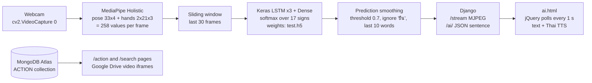
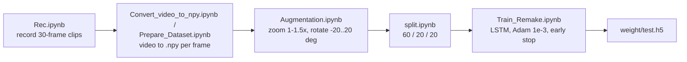

# Sign Language Recognition

A Django website that watches a webcam and translates 17 Thai sign-language gestures into text in real time, built so hearing, deaf and speech-impaired people in Thailand can talk to each other more easily.

Stack: Python, MediaPipe Holistic, OpenCV, TensorFlow/Keras (LSTM), Django 4.1 (MVT), MongoDB Atlas via pymongo, HTML/CSS/JS with jQuery.

## What it does

| Feature | Who uses it | Where in code |
|---|---|---|
| Live webcam recognition: MJPEG stream with landmarks drawn, recognised words shown under the video | Signer and the person they talk to | `slrsite/slrsite/camera.py`, `web/views.py` (`video_stream`, `get_data`), `templates/ai.html` |
| Read the recognised words aloud (Thai TTS via Google Translate URL) | Hearing listener | `templates/ai.html` (speaker button) |
| Speak a word (Web Speech API, `th-TH`) to search for its sign video | Hearing person learning a sign | `templates/ai.html`, `templates/voice.html` |
| Browse or search the sign dictionary: one Google Drive video per word | Anyone learning Thai signs | `slrsite/slrsite/actionModel.py`, `templates/action.html`, `templates/search.html` |
| Home, about, team pages with a usage pop-up | Visitors | `templates/index.html`, `about.html`, `team.html`, `static/script.js` |
| Data collection, keypoint extraction, training and evaluation notebooks | Developers | `slrai/*.ipynb` |

## Architecture





Each webcam frame goes through MediaPipe Holistic; pose landmarks (x, y, z, visibility) and both hand landmarks (x, y, z) are flattened into a 258-value vector, with zeros when a part is not detected. The last 30 vectors form one sequence that a stacked LSTM (64, 128, 64 units) followed by Dense 64 and 32 classifies into one of 17 signs. A word is appended to the running sentence only when the last 10 predictions agree, the confidence is above 0.7 and the class is not the idle pose `ยืน`. Django streams the annotated frames as `multipart/x-mixed-replace` and exposes the current sentence as JSON, which the page polls once a second. The sign dictionary is independent of the model: `actionModel.py` reads `{action, url}` documents from a MongoDB Atlas collection and the templates embed each Google Drive URL in an iframe.

## Repository layout

```
.
├── ACTION.json          # 16 dictionary entries {action, url} exported from MongoDB (Compass import)
├── LICENSE.md           # MIT, 2023 KUKPS_CPE14_MIT_GROUP5
├── requirements.txt     # Django 4.1.6, tensorflow 2.11.0, opencv 4.7, numpy 1.24.1, scikit-learn 1.2.1 ...
├── documents/           # Project charter, user manual, technical doc, slide deck (PDF, Thai)
├── slrai/               # Jupyter notebooks for data and training
│   ├── Rec.ipynb                  # record 30-frame webcam clips per sign
│   ├── Convert_video_to_npy.ipynb # MediaPipe keypoints -> one .npy per frame (frame gap option)
│   ├── Prepare_Dataset.ipynb      # same, every frame
│   ├── Augmentation.ipynb         # zoom / rotate / mixed video augmentation
│   ├── split.ipynb, sort.ipynb    # 60/20/20 split and sequential renaming
│   └── Train_Remake.ipynb         # build, train, evaluate the LSTM
└── slrsite/             # Django project
    ├── manage.py
    ├── test.h5          # weights loaded by camera.py (about 2.9 MB)
    ├── action.h5        # older weights, not referenced by current code
    ├── db.sqlite3       # empty (0 bytes); Django models are unused
    ├── slrsite/         # settings.py, urls.py, camera.py (model + stream), actionModel.py (MongoDB)
    ├── web/             # views.py and urls.py for all pages
    ├── templates/       # index, about, team, ai, action, search, voice
    └── static/          # style.css, script.js, logo, team photos
```

## Run locally

Prerequisites: Python 3 (no version is pinned; the pins in `requirements.txt` are from early 2023, TensorFlow 2.11 / numpy 1.24.1), a webcam, and network access to MongoDB Atlas and Google Drive. `requirements.txt` is missing three imports the code needs: `mediapipe`, `pymongo` and `imutils` (notebooks only). `tensorflow-intel` and `sklearn==0.0.post1` are Windows/placeholder pins you may need to drop on other platforms.

```bash
git clone https://github.com/sophonwit379/MIT_Sign_Language_Recognition.git
cd MIT_Sign_Language_Recognition
pip install -r requirements.txt mediapipe pymongo
cd slrsite
python manage.py runserver          # Django default: http://127.0.0.1:8000/
```

Run the server from inside `slrsite/`: `camera.py` loads `test.h5` by relative path at import time. Routes: `/`, `/about`, `/team`, `/ai` (recognition page), `/stream`, `/ai/` (JSON), `/action`, `/search?search=<word>`, `/voice`, `/admin/`. The dictionary pages need the MongoDB Atlas connection string that is hard-coded in `actionModel.py`; to use your own cluster, import `ACTION.json` with MongoDB Compass into database `SLR`, collection `ACTION`, and change the URI. The original dataset videos are on [Google Drive](https://drive.google.com/file/d/17-hhCr_5tQIkMToAlevN3njRZiemX1wO/view?usp=share_link). Voice search uses `webkitSpeechRecognition`, so it works in Chromium browsers only.

## Training

1. `Rec.ipynb`: records 640x480 @ 25 fps clips of exactly 30 frames from the webcam, one folder per sign. The team recorded the dataset themselves because no suitable Thai dataset existed.
2. `Convert_video_to_npy.ipynb` / `Prepare_Dataset.ipynb`: run MediaPipe Holistic on each frame and save a 258-value `.npy` per frame.
3. `Augmentation.ipynb`: writes augmented copies of each clip (random zoom 1.0-1.5x, rotation -20..20 degrees, or both).
4. `split.ipynb`, `sort.ipynb`: random 60/20/20 train/val/test split, then rename clips `0..N`.
5. `Train_Remake.ipynb`: load 60 train, 20 val and 20 test sequences per class into arrays of shape `(N, 30, 258)` (train 1020, val 340, test 340; frame 0 is zeroed), train with Adam lr 0.001, batch 32, up to 500 epochs with EarlyStopping (patience 10) and a checkpoint to `weight/test.h5`, then print a confusion matrix and classification report.

Classes (17, label order in `camera.py` and `Train_Remake.ipynb`): โกรธ angry, ร้องให้ cry, ง่าย easy, สบายดี fine, ลืม forgot, อิ่ม full, ดีใจ happy, ยาก hard, สวัสดี hello, ชอบ like, รัก love, ฉัน me, คิดถึง miss, เศร้า sad, กลัว scare, ยืน stand (idle, never output), คุณ you. `ACTION.json` holds the 16 non-idle words for the dictionary and uses the synonyms เสียใจ and เธอ for sad and you.

Reported results (test set, `Train_Remake.ipynb` output and slide 16-17 of `documents/Presentation_G5.pdf`): without augmentation, 100 clips per sign, accuracy 0.7618, loss 0.5604; training stopped at epoch 41. Adding augmentation made things worse: 3x zoom 0.6824, 5x zoom+rotate 0.600, 10x 0.4206. Per-class F1 ranges from 0.39 (like) to 1.00 (scare).

## Status

Course project for 02204372 Management of Information Technology (semester 2/2565, i.e. 2022-2023), Computer Engineering, Faculty of Engineering, Kasetsart University Kamphaeng Saen campus, group G5, advised by ดร.บุญรัตน์ เผดิมรอด. Team: อลิสา กระจ่างแจ่ม (project manager, [NewAlisa](https://github.com/NewAlisa)), อัคมาลริซาล รัมลี (support, [smanmonet](https://github.com/smanmonet)), ณัฐวุฒิ รอดเลิศ (web, [ntwww](https://github.com/ntwww)), เกริก กลมเกลี้ยง / Krirk Klomkliang (web + AI, [ziedshiro](https://github.com/ziedshiro)), โสภณวิชญ์ ควันไชย (web + AI, [sophonwit379](https://github.com/sophonwit379)). Submitted March 2023; this repository is a single-commit snapshot last pushed April 2025.

Complete: data collection, keypoint pipeline, trained LSTM, Django site with live recognition, dictionary search, TTS and voice search, plus Thai documentation in `documents/`.

Known gaps:
- Single words only, no sentences; hands and pose only, no facial expression; desktop browsers only.
- Settings and the database connection string are hardcoded in `settings.py` and `actionModel.py`; move them to environment variables before deploying.
- `requirements.txt` is incomplete (`mediapipe`, `pymongo`, `imutils` are missing) and the notebooks still carry absolute Windows paths from the training machine.
- Model weights and several large photos are committed; they belong in a release or LFS.

If I continued it: replace the `ยืน`-only idle filter with a proper no-sign class, collect more signers to lift the 0.76 test accuracy, and read the model path and Mongo URI from Django settings.

Credit: the keypoint-to-LSTM approach follows [Nicholas Renotte](https://www.youtube.com/@NicholasRenotte)'s tutorial. Licensed under the MIT License (see `LICENSE.md`).
